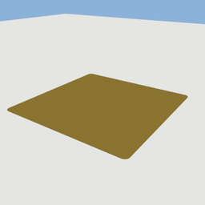
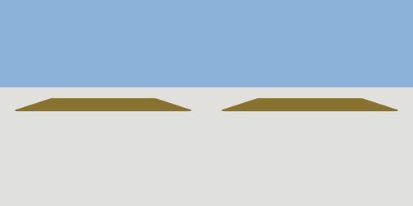

# floor_pad

`asset: floor_pad.yaml` · [source](../../../assets/floor_pad.yaml) · `decor.marking`

 

A painted square on the ground to stand on. It marks a quest's start line or
a waypoint. Origin: bottom centre; 1 cm thick, walkable, no collider.

```yaml
place:
  floor_pad: {asset: floor_pad.yaml, params: {width: 2.4, depth: 2.4}}
```

## Params

| Param | Default | Choices | Notes |
| --- | --- | --- | --- |
| `width` | `2.4` |  |  |
| `depth` | `2.4` |  |  |

## Size

2.4 x 0.01 x 2.4 m (x, y, z); geometry (-1.2, 0, -1.2) to (1.2, 0.01, 1.2) from the origin; 140 triangles

## Parts

`pad` (extrude)
