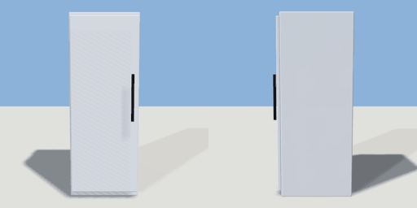

# fridge

`asset: fridge.yaml` · [source](../../../assets/fridge.yaml) · `kitchen.fridge` `appliance`

 

A tall stainless commercial fridge with one full-height door (press E to
open it; it swings on its left side). Against a wall, door facing +Z.

```yaml
place:
  fridge: {asset: fridge.yaml, state: open}
```

## Size

0.75 x 2 x 0.865 m (x, y, z); geometry (-0.375, 0, -0.39) to (0.375, 2, 0.475) from the origin; 456 triangles

## Parts

`cabinet` (cube), `door` (cube), `handle` (cylinder)

## Interactions

door: closed* -> open, open -> closed (* initial; rotates door, handle)

## Clearance

front 0.9
