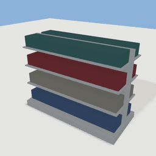
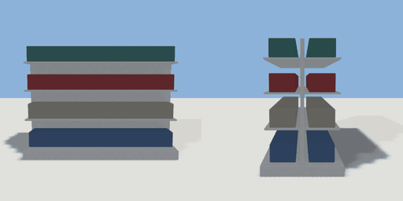

# gondola

`asset: gondola.yaml` · [source](../../../assets/gondola.yaml) · `shop.gondola` `furniture.shelving`

 

A gondola: a free-standing double-sided shop shelf with stock on both
faces and an end cap. Runs along X; shoppers use both long sides.

```yaml
place:
  gondola: {asset: gondola.yaml, params: {length: 2}}
```

## Params

| Param | Default | Choices | Notes |
| --- | --- | --- | --- |
| `length` | `2` |  |  |

## Size

2 x 1.46 x 0.9 m (x, y, z); geometry (-1, 0, -0.45) to (1, 1.46, 0.45) from the origin; 3672 triangles

## Parts

`spine` (cube), `base` (cube), `shelf_f_0` (cube), `stock_f_0` (cube), `shelf_f_1` (cube), `stock_f_1` (cube), `shelf_f_2` (cube), `stock_f_2` (cube), `shelf_f_3` (cube), `stock_f_3` (cube), `shelf_b_0` (cube), `stock_b_0` (cube), `shelf_b_1` (cube), `stock_b_1` (cube), `shelf_b_2` (cube), `stock_b_2` (cube), `shelf_b_3` (cube), `stock_b_3` (cube)

## Clearance

front 0.9, back 0.9
