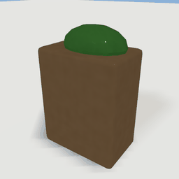
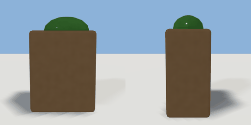

# grocery_bag

`asset: grocery_bag.yaml` · [source](../../../assets/grocery_bag.yaml) · `food.raw`

 

A paper bag of groceries with greens showing at the top: raw food out of the fridge
(items/raw_food.yaml), before a range or a microwave makes a meal of it.

```yaml
place:
  grocery_bag: {asset: grocery_bag.yaml}
```

## Size

0.16 x 0.24 x 0.1 m (x, y, z); geometry (-0.08, 0, -0.05) to (0.08, 0.24, 0.05) from the origin; 332 triangles

## Parts

`bag` (cube), `greens` (ellipsoid)
