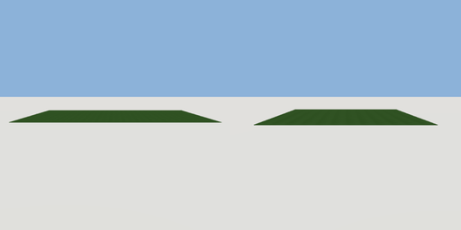

# ground

`asset: ground.yaml` · [source](../../../assets/ground.yaml) · `terrain.ground`

 

Ground plane - flat grass surface

```yaml
place:
  ground: {asset: ground.yaml, params: {width: 30, thickness: 0.05}}
```

## Params

| Param | Default | Choices | Notes |
| --- | --- | --- | --- |
| `width` | `30` |  |  |
| `thickness` | `0.05` |  |  |
| `depth` | `24` |  |  |

## Size

30 x 0.05 x 24 m (x, y, z); geometry (-15, 0, -12) to (15, 0.05, 12) from the origin; 12 triangles

## Parts

`surface` (cube)

## Surfaces

| Surface | Size (u x v, m) | Facing |
| --- | --- | --- |
| `top` | 30 x 24 | +Y |
