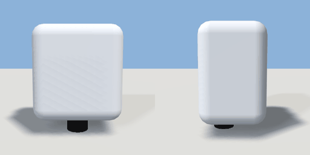

# hand_dryer

`asset: hand_dryer.yaml` · [source](../../../assets/hand_dryer.yaml) · `bathroom.hand_dryer` `decor.wall`

 

A wall-mounted hand dryer (brushed steel). Wall-mounted: origin on the wall
plane at its bottom centre, depth along +Z.

```yaml
place:
  hand_dryer: {asset: hand_dryer.yaml}
```

## Size

0.28 x 0.34 x 0.2 m (x, y, z); geometry (-0.14, -0.04, 0) to (0.14, 0.3, 0.2) from the origin; 348 triangles

## Parts

`body` (cube), `nozzle` (cylinder)
