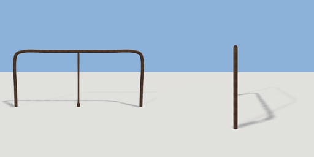

# handrail

`asset: handrail.yaml` · [source](../../../assets/handrail.yaml) · `architecture.handrail`

 

Stair/landing handrail: turned posts and a round rail swept along a path
that bends down into the floor at both ends. Origin bottom_center; the rail
runs along X.

```yaml
place:
  handrail: {asset: handrail.yaml, params: {length: 2, height: 0.9}}
```

## Params

| Param | Default | Choices | Notes |
| --- | --- | --- | --- |
| `length` | `2` |  |  |
| `height` | `0.9` |  |  |

## Size

2 x 0.9 x 0.08 m (x, y, z); geometry (-1.029, 0, -0.024) to (1.029, 0.906, 0.024) from the origin; 4204 triangles

## Parts

`rail` (sweep), `post_mid` (lathe)
