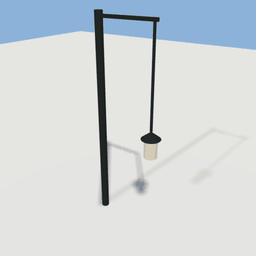
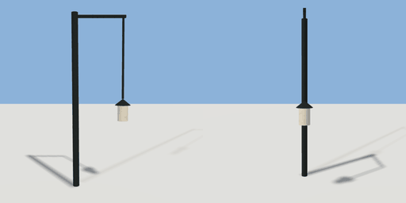

# hanging_chain

`asset: hanging_chain.yaml` · [source](../../../assets/hanging_chain.yaml) · `decor.chain` `mechanism.chain`

 

A chain with a lantern, hanging from a bracket on a post. A mechanism whose links are
each a body pinned to the one before (`to: previous`), the first to the bracket, so it
swings when pushed and settles. Origin: the post's foot; the bracket reaches out along +X.

```yaml
place:
  hanging_chain: {asset: hanging_chain.yaml, params: {height: 3.2, links: 6}}
```

## Params

| Param | Default | Choices | Notes |
| --- | --- | --- | --- |
| `height` | `3.2` |  | the bracket |
| `links` | `6` |  |  |
| `link` | `0.25` |  | each link's length |

## Size

1.11 x 3.3 x 0.3 m (x, y, z); geometry (-0.06, 0, -0.15) to (1.05, 3.3, 0.15) from the origin; 628 triangles

## Parts

`post` (cylinder), `bracket` (cube), `ring` (cylinder), `lamp_cap` (cone), `lamp_body` (cylinder)

## Light

type omni, color [1,0.8,0.5], energy 0.6, range 5, offset [0.9,1.4,0], auto night
