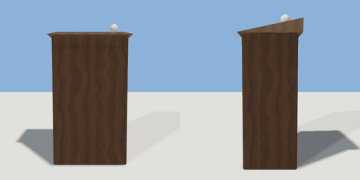

# host_stand

`asset: host_stand.yaml` · [source](../../../assets/host_stand.yaml) · `furniture.host_stand`

 

A host stand by a restaurant's door: a slim podium with a sloped top.
Staff stand behind it (-Z) facing the door (+Z).

```yaml
place:
  host_stand: {asset: host_stand.yaml}
```

## Size

0.66 x 1.2 x 0.48 m (x, y, z); geometry (-0.33, 0, -0.24) to (0.33, 1.2, 0.24) from the origin; 428 triangles

## Parts

`body` (cube), `top` (prism), `lamp` (sphere)

## Affordances

stand at (0, 0, -0.55) [staff, host]

## Clearance

front 0.8, back 0.7
