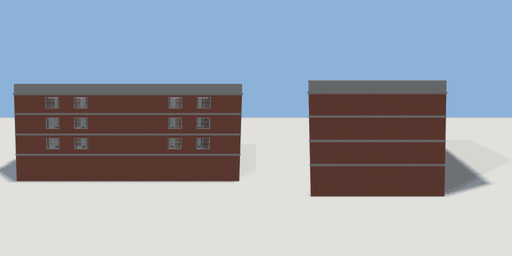

# hotel

`asset: hotel.yaml` · [source](../../../assets/hotel.yaml) · `building.hotel`

 

A generated hotel: lobby level plus three guest floors, stair cores at
both ends, flat roof with a parapet. Guest rooms are furnished from their
room archetypes.

```yaml
place:
  hotel: {asset: hotel.yaml}
```

## Size

30.3 x 12.85 x 15.3 m (x, y, z); geometry (-15.29, -0.12, -9.25) to (15.29, 13.1, 7.79) from the origin; 769028 triangles

## Rooms

lobby (lobby), lounge (lounge), restaurant (restaurant), reception (reception), restroom_a (restroom), restroom_b (restroom), back_of_house (back_of_house), lift_shaft (lift_shaft), lift_plant_west (service), lift_plant_east (service), stair_west (stair), stair_east (stair), corridor (hallway), stair_west (stair), stair_east (stair), lift_lobby (lift_lobby), service (service), lift_shaft (lift_shaft), lift_plant_west (service), lift_plant_east (service), room_101_entry (corridor), room_101_bath (hotel_bathroom), room_101 (hotel_bedroom), room_102_entry (corridor), room_102_bath (hotel_bathroom), room_102 (hotel_bedroom), room_103_entry (corridor), room_103_bath (hotel_bathroom), room_103 (hotel_bedroom), room_104_entry (corridor), room_104_bath (hotel_bathroom), room_104 (hotel_bedroom), room_105_entry (corridor), room_105_bath (hotel_bathroom), room_105 (hotel_bedroom), room_106_entry (corridor), room_106_bath (hotel_bathroom), room_106 (hotel_bedroom), room_107_entry (corridor), room_107_bath (hotel_bathroom), room_107 (hotel_bedroom), room_108_entry (corridor), room_108_bath (hotel_bathroom), room_108 (hotel_bedroom), corridor (hallway), stair_west (stair), stair_east (stair), lift_lobby (lift_lobby), service (service), lift_shaft (lift_shaft), lift_plant_west (service), lift_plant_east (service), room_201_entry (corridor), room_201_bath (hotel_bathroom), room_201 (hotel_bedroom), room_202_entry (corridor), room_202_bath (hotel_bathroom), room_202 (hotel_bedroom), room_203_entry (corridor), room_203_bath (hotel_bathroom), room_203 (hotel_bedroom), room_204_entry (corridor), room_204_bath (hotel_bathroom), room_204 (hotel_bedroom), room_205_entry (corridor), room_205_bath (hotel_bathroom), room_205 (hotel_bedroom), room_206_entry (corridor), room_206_bath (hotel_bathroom), room_206 (hotel_bedroom), room_207_entry (corridor), room_207_bath (hotel_bathroom), room_207 (hotel_bedroom), room_208_entry (corridor), room_208_bath (hotel_bathroom), room_208 (hotel_bedroom), corridor (hallway), stair_west (stair), stair_east (stair), lift_lobby (lift_lobby), service (service), lift_shaft (lift_shaft), lift_plant_west (service), lift_plant_east (service), room_301_entry (corridor), room_301_bath (hotel_bathroom), room_301 (hotel_bedroom), room_302_entry (corridor), room_302_bath (hotel_bathroom), room_302 (hotel_bedroom), room_303_entry (corridor), room_303_bath (hotel_bathroom), room_303 (hotel_bedroom), room_304_entry (corridor), room_304_bath (hotel_bathroom), room_304 (hotel_bedroom), room_305_entry (corridor), room_305_bath (hotel_bathroom), room_305 (hotel_bedroom), room_306_entry (corridor), room_306_bath (hotel_bathroom), room_306 (hotel_bedroom), room_307_entry (corridor), room_307_bath (hotel_bathroom), room_307 (hotel_bedroom), room_308_entry (corridor), room_308_bath (hotel_bathroom), room_308 (hotel_bedroom)
