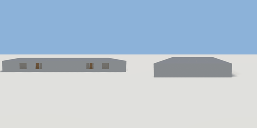

# hotel_floor

`asset: hotel_floor.yaml` · [source](../../../assets/hotel_floor.yaml) · `building.hotel_floor`

 

A generated hotel guest floor: double-loaded corridor with fire stairs at
the ends, a lift lobby mid-floor and ensuite guest rooms on both sides.
See geogen/generators/plan_layouts.py for the layout parameters.

```yaml
place:
  hotel_floor: {asset: hotel_floor.yaml}
```

## Size

30.3 x 2.75 x 15.3 m (x, y, z); geometry (-15.15, -0.05, -7.65) to (15.15, 2.7, 7.65) from the origin; 75144 triangles

## Rooms

corridor (hallway), stair_west (stair), stair_east (stair), lift_lobby (lift_lobby), service (service), lift_shaft (lift_shaft), lift_plant_west (service), lift_plant_east (service), room_101_entry (corridor), room_101_bath (hotel_bathroom), room_101 (hotel_bedroom), room_102_entry (corridor), room_102_bath (hotel_bathroom), room_102 (hotel_bedroom), room_103_entry (corridor), room_103_bath (hotel_bathroom), room_103 (hotel_bedroom), room_104_entry (corridor), room_104_bath (hotel_bathroom), room_104 (hotel_bedroom), room_105_entry (corridor), room_105_bath (hotel_bathroom), room_105 (hotel_bedroom), room_106_entry (corridor), room_106_bath (hotel_bathroom), room_106 (hotel_bedroom), room_107_entry (corridor), room_107_bath (hotel_bathroom), room_107 (hotel_bedroom), room_108_entry (corridor), room_108_bath (hotel_bathroom), room_108 (hotel_bedroom)

## Surfaces

| Surface | Size (u x v, m) | Facing |
| --- | --- | --- |
| `corridor.floor` | 23.88 x 1.68 | +Y |
| `corridor.ceiling` | 23.88 x 1.68 | -Y |
| `corridor.north_wall` | 23.88 x 2.5 | -Z |
| `corridor.south_wall` | 23.88 x 2.5 | +Z |
| `corridor.east_wall` | 1.68 x 2.5 | -X |
| `corridor.west_wall` | 1.68 x 2.5 | +X |
| `stair_west.floor` | 2.79 x 14.7 | +Y |
| `stair_west.ceiling` | 2.79 x 14.7 | -Y |
| `stair_west.north_wall` | 2.79 x 2.5 | -Z |
| `stair_west.south_wall` | 2.79 x 2.5 | +Z |
| `stair_west.east_wall` | 14.7 x 2.5 | -X |
| `stair_west.west_wall` | 14.7 x 2.5 | +X |
| `stair_west.north_exterior` | 2.79 x 2.5 | +Z |
| `stair_west.south_exterior` | 2.79 x 2.5 | -Z |
| `stair_west.west_exterior` | 14.7 x 2.5 | -X |
| `stair_east.floor` | 2.79 x 14.7 | +Y |
| `stair_east.ceiling` | 2.79 x 14.7 | -Y |
| `stair_east.north_wall` | 2.79 x 2.5 | -Z |
| `stair_east.south_wall` | 2.79 x 2.5 | +Z |
| `stair_east.east_wall` | 14.7 x 2.5 | -X |
| `stair_east.west_wall` | 14.7 x 2.5 | +X |
| `stair_east.north_exterior` | 2.79 x 2.5 | +Z |
| `stair_east.south_exterior` | 2.79 x 2.5 | -Z |
| `stair_east.east_exterior` | 14.7 x 2.5 | +X |
| `lift_lobby.floor` | 8.68 x 4.28 | +Y |
| `lift_lobby.ceiling` | 8.68 x 4.28 | -Y |
| `lift_lobby.north_wall` | 8.68 x 2.5 | -Z |
| `lift_lobby.south_wall` | 8.68 x 2.5 | +Z |
| `lift_lobby.east_wall` | 4.28 x 2.5 | -X |
| `lift_lobby.west_wall` | 4.28 x 2.5 | +X |
| `service.floor` | 8.68 x 6.39 | +Y |
| `service.ceiling` | 8.68 x 6.39 | -Y |
| `service.north_wall` | 8.68 x 2.5 | -Z |
| `service.south_wall` | 8.68 x 2.5 | +Z |
| `service.east_wall` | 6.39 x 2.5 | -X |
| `service.west_wall` | 6.39 x 2.5 | +X |
| `service.south_exterior` | 8.68 x 2.5 | -Z |
| `lift_shaft.floor` | 2.08 x 1.99 | +Y |
| `lift_shaft.ceiling` | 2.08 x 1.99 | -Y |
| `lift_shaft.north_wall` | 2.08 x 2.5 | -Z |
| `lift_shaft.south_wall` | 2.08 x 2.5 | +Z |
| `lift_shaft.east_wall` | 1.99 x 2.5 | -X |
| `lift_shaft.west_wall` | 1.99 x 2.5 | +X |
| `lift_shaft.north_exterior` | 2.08 x 2.5 | +Z |
| `lift_plant_west.floor` | 3.18 x 1.99 | +Y |
| `lift_plant_west.ceiling` | 3.18 x 1.99 | -Y |
| `lift_plant_west.north_wall` | 3.18 x 2.5 | -Z |
| `lift_plant_west.south_wall` | 3.18 x 2.5 | +Z |
| `lift_plant_west.east_wall` | 1.99 x 2.5 | -X |
| `lift_plant_west.west_wall` | 1.99 x 2.5 | +X |
| `lift_plant_west.north_exterior` | 3.18 x 2.5 | +Z |
| `lift_plant_east.floor` | 3.18 x 1.99 | +Y |
| `lift_plant_east.ceiling` | 3.18 x 1.99 | -Y |
| `lift_plant_east.north_wall` | 3.18 x 2.5 | -Z |
| `lift_plant_east.south_wall` | 3.18 x 2.5 | +Z |
| `lift_plant_east.east_wall` | 1.99 x 2.5 | -X |
| `lift_plant_east.west_wall` | 1.99 x 2.5 | +X |
| `lift_plant_east.north_exterior` | 3.18 x 2.5 | +Z |
| `room_101_entry.floor` | 1.68 x 2.28 | +Y |
| `room_101_entry.ceiling` | 1.68 x 2.28 | -Y |
| `room_101_entry.north_wall` | 1.68 x 2.5 | -Z |
| `room_101_entry.south_wall` | 1.68 x 2.5 | +Z |
| `room_101_entry.east_wall` | 2.28 x 2.5 | -X |
| `room_101_entry.west_wall` | 2.28 x 2.5 | +X |
| `room_101_bath.floor` | 1.88 x 2.28 | +Y |
| `room_101_bath.ceiling` | 1.88 x 2.28 | -Y |
| `room_101_bath.north_wall` | 1.88 x 2.5 | -Z |
| `room_101_bath.south_wall` | 1.88 x 2.5 | +Z |
| `room_101_bath.east_wall` | 2.28 x 2.5 | -X |
| `room_101_bath.west_wall` | 2.28 x 2.5 | +X |
| `room_101.floor` | 3.68 x 3.99 | +Y |
| `room_101.ceiling` | 3.68 x 3.99 | -Y |
| `room_101.north_wall` | 3.68 x 2.5 | -Z |
| `room_101.south_wall` | 3.68 x 2.5 | +Z |
| `room_101.east_wall` | 3.99 x 2.5 | -X |
| `room_101.west_wall` | 3.99 x 2.5 | +X |
| `room_101.north_exterior` | 3.68 x 2.5 | +Z |
| `room_102_entry.floor` | 1.68 x 2.28 | +Y |
| `room_102_entry.ceiling` | 1.68 x 2.28 | -Y |
| `room_102_entry.north_wall` | 1.68 x 2.5 | -Z |
| `room_102_entry.south_wall` | 1.68 x 2.5 | +Z |
| `room_102_entry.east_wall` | 2.28 x 2.5 | -X |
| `room_102_entry.west_wall` | 2.28 x 2.5 | +X |
| `room_102_bath.floor` | 1.88 x 2.28 | +Y |
| `room_102_bath.ceiling` | 1.88 x 2.28 | -Y |
| `room_102_bath.north_wall` | 1.88 x 2.5 | -Z |
| `room_102_bath.south_wall` | 1.88 x 2.5 | +Z |
| `room_102_bath.east_wall` | 2.28 x 2.5 | -X |
| `room_102_bath.west_wall` | 2.28 x 2.5 | +X |
| `room_102.floor` | 3.68 x 3.99 | +Y |
| `room_102.ceiling` | 3.68 x 3.99 | -Y |
| `room_102.north_wall` | 3.68 x 2.5 | -Z |
| `room_102.south_wall` | 3.68 x 2.5 | +Z |
| `room_102.east_wall` | 3.99 x 2.5 | -X |
| `room_102.west_wall` | 3.99 x 2.5 | +X |
| `room_102.north_exterior` | 3.68 x 2.5 | +Z |
| `room_103_entry.floor` | 1.68 x 2.28 | +Y |
| `room_103_entry.ceiling` | 1.68 x 2.28 | -Y |
| `room_103_entry.north_wall` | 1.68 x 2.5 | -Z |
| `room_103_entry.south_wall` | 1.68 x 2.5 | +Z |
| `room_103_entry.east_wall` | 2.28 x 2.5 | -X |
| `room_103_entry.west_wall` | 2.28 x 2.5 | +X |
| `room_103_bath.floor` | 1.88 x 2.28 | +Y |
| `room_103_bath.ceiling` | 1.88 x 2.28 | -Y |
| `room_103_bath.north_wall` | 1.88 x 2.5 | -Z |
| `room_103_bath.south_wall` | 1.88 x 2.5 | +Z |
| `room_103_bath.east_wall` | 2.28 x 2.5 | -X |
| `room_103_bath.west_wall` | 2.28 x 2.5 | +X |
| `room_103.floor` | 3.68 x 3.99 | +Y |
| `room_103.ceiling` | 3.68 x 3.99 | -Y |
| `room_103.north_wall` | 3.68 x 2.5 | -Z |
| `room_103.south_wall` | 3.68 x 2.5 | +Z |
| `room_103.east_wall` | 3.99 x 2.5 | -X |
| `room_103.west_wall` | 3.99 x 2.5 | +X |
| `room_103.north_exterior` | 3.68 x 2.5 | +Z |
| `room_104_entry.floor` | 1.68 x 2.28 | +Y |
| `room_104_entry.ceiling` | 1.68 x 2.28 | -Y |
| `room_104_entry.north_wall` | 1.68 x 2.5 | -Z |
| `room_104_entry.south_wall` | 1.68 x 2.5 | +Z |
| `room_104_entry.east_wall` | 2.28 x 2.5 | -X |
| `room_104_entry.west_wall` | 2.28 x 2.5 | +X |
| `room_104_bath.floor` | 1.88 x 2.28 | +Y |
| `room_104_bath.ceiling` | 1.88 x 2.28 | -Y |
| `room_104_bath.north_wall` | 1.88 x 2.5 | -Z |
| `room_104_bath.south_wall` | 1.88 x 2.5 | +Z |
| `room_104_bath.east_wall` | 2.28 x 2.5 | -X |
| `room_104_bath.west_wall` | 2.28 x 2.5 | +X |
| `room_104.floor` | 3.68 x 3.99 | +Y |
| `room_104.ceiling` | 3.68 x 3.99 | -Y |
| `room_104.north_wall` | 3.68 x 2.5 | -Z |
| `room_104.south_wall` | 3.68 x 2.5 | +Z |
| `room_104.east_wall` | 3.99 x 2.5 | -X |
| `room_104.west_wall` | 3.99 x 2.5 | +X |
| `room_104.north_exterior` | 3.68 x 2.5 | +Z |
| `room_105_entry.floor` | 1.68 x 2.28 | +Y |
| `room_105_entry.ceiling` | 1.68 x 2.28 | -Y |
| `room_105_entry.north_wall` | 1.68 x 2.5 | -Z |
| `room_105_entry.south_wall` | 1.68 x 2.5 | +Z |
| `room_105_entry.east_wall` | 2.28 x 2.5 | -X |
| `room_105_entry.west_wall` | 2.28 x 2.5 | +X |
| `room_105_bath.floor` | 1.88 x 2.28 | +Y |
| `room_105_bath.ceiling` | 1.88 x 2.28 | -Y |
| `room_105_bath.north_wall` | 1.88 x 2.5 | -Z |
| `room_105_bath.south_wall` | 1.88 x 2.5 | +Z |
| `room_105_bath.east_wall` | 2.28 x 2.5 | -X |
| `room_105_bath.west_wall` | 2.28 x 2.5 | +X |
| `room_105.floor` | 3.68 x 3.99 | +Y |
| `room_105.ceiling` | 3.68 x 3.99 | -Y |
| `room_105.north_wall` | 3.68 x 2.5 | -Z |
| `room_105.south_wall` | 3.68 x 2.5 | +Z |
| `room_105.east_wall` | 3.99 x 2.5 | -X |
| `room_105.west_wall` | 3.99 x 2.5 | +X |
| `room_105.south_exterior` | 3.68 x 2.5 | -Z |
| `room_106_entry.floor` | 1.68 x 2.28 | +Y |
| `room_106_entry.ceiling` | 1.68 x 2.28 | -Y |
| `room_106_entry.north_wall` | 1.68 x 2.5 | -Z |
| `room_106_entry.south_wall` | 1.68 x 2.5 | +Z |
| `room_106_entry.east_wall` | 2.28 x 2.5 | -X |
| `room_106_entry.west_wall` | 2.28 x 2.5 | +X |
| `room_106_bath.floor` | 1.88 x 2.28 | +Y |
| `room_106_bath.ceiling` | 1.88 x 2.28 | -Y |
| `room_106_bath.north_wall` | 1.88 x 2.5 | -Z |
| `room_106_bath.south_wall` | 1.88 x 2.5 | +Z |
| `room_106_bath.east_wall` | 2.28 x 2.5 | -X |
| `room_106_bath.west_wall` | 2.28 x 2.5 | +X |
| `room_106.floor` | 3.68 x 3.99 | +Y |
| `room_106.ceiling` | 3.68 x 3.99 | -Y |
| `room_106.north_wall` | 3.68 x 2.5 | -Z |
| `room_106.south_wall` | 3.68 x 2.5 | +Z |
| `room_106.east_wall` | 3.99 x 2.5 | -X |
| `room_106.west_wall` | 3.99 x 2.5 | +X |
| `room_106.south_exterior` | 3.68 x 2.5 | -Z |
| `room_107_entry.floor` | 1.68 x 2.28 | +Y |
| `room_107_entry.ceiling` | 1.68 x 2.28 | -Y |
| `room_107_entry.north_wall` | 1.68 x 2.5 | -Z |
| `room_107_entry.south_wall` | 1.68 x 2.5 | +Z |
| `room_107_entry.east_wall` | 2.28 x 2.5 | -X |
| `room_107_entry.west_wall` | 2.28 x 2.5 | +X |
| `room_107_bath.floor` | 1.88 x 2.28 | +Y |
| `room_107_bath.ceiling` | 1.88 x 2.28 | -Y |
| `room_107_bath.north_wall` | 1.88 x 2.5 | -Z |
| `room_107_bath.south_wall` | 1.88 x 2.5 | +Z |
| `room_107_bath.east_wall` | 2.28 x 2.5 | -X |
| `room_107_bath.west_wall` | 2.28 x 2.5 | +X |
| `room_107.floor` | 3.68 x 3.99 | +Y |
| `room_107.ceiling` | 3.68 x 3.99 | -Y |
| `room_107.north_wall` | 3.68 x 2.5 | -Z |
| `room_107.south_wall` | 3.68 x 2.5 | +Z |
| `room_107.east_wall` | 3.99 x 2.5 | -X |
| `room_107.west_wall` | 3.99 x 2.5 | +X |
| `room_107.south_exterior` | 3.68 x 2.5 | -Z |
| `room_108_entry.floor` | 1.68 x 2.28 | +Y |
| `room_108_entry.ceiling` | 1.68 x 2.28 | -Y |
| `room_108_entry.north_wall` | 1.68 x 2.5 | -Z |
| `room_108_entry.south_wall` | 1.68 x 2.5 | +Z |
| `room_108_entry.east_wall` | 2.28 x 2.5 | -X |
| `room_108_entry.west_wall` | 2.28 x 2.5 | +X |
| `room_108_bath.floor` | 1.88 x 2.28 | +Y |
| `room_108_bath.ceiling` | 1.88 x 2.28 | -Y |
| `room_108_bath.north_wall` | 1.88 x 2.5 | -Z |
| `room_108_bath.south_wall` | 1.88 x 2.5 | +Z |
| `room_108_bath.east_wall` | 2.28 x 2.5 | -X |
| `room_108_bath.west_wall` | 2.28 x 2.5 | +X |
| `room_108.floor` | 3.68 x 3.99 | +Y |
| `room_108.ceiling` | 3.68 x 3.99 | -Y |
| `room_108.north_wall` | 3.68 x 2.5 | -Z |
| `room_108.south_wall` | 3.68 x 2.5 | +Z |
| `room_108.east_wall` | 3.99 x 2.5 | -X |
| `room_108.west_wall` | 3.99 x 2.5 | +X |
| `room_108.south_exterior` | 3.68 x 2.5 | -Z |
