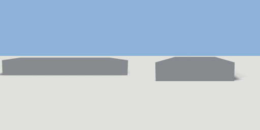

# hotel_lobby

`asset: hotel_lobby.yaml` · [source](../../../assets/hotel_lobby.yaml) · `building.hotel_lobby`

 

Generated hotel ground floor: street entrance, lobby, reception, lounge,
restaurant, restrooms and back-of-house.

```yaml
place:
  hotel_lobby: {asset: hotel_lobby.yaml}
```

## Size

30.3 x 3.65 x 15.3 m (x, y, z); geometry (-15.15, -0.05, -7.668) to (15.15, 3.6, 7.65) from the origin; 34292 triangles

## Rooms

lobby (lobby), lounge (lounge), restaurant (restaurant), reception (reception), restroom_a (restroom), restroom_b (restroom), back_of_house (back_of_house), lift_shaft (lift_shaft), lift_plant_west (service), lift_plant_east (service), stair_west (stair), stair_east (stair)

## Surfaces

| Surface | Size (u x v, m) | Facing |
| --- | --- | --- |
| `lobby.floor` | 5.88 x 9.79 | +Y |
| `lobby.ceiling` | 5.88 x 9.79 | -Y |
| `lobby.north_wall` | 5.88 x 3.4 | -Z |
| `lobby.south_wall` | 5.88 x 3.4 | +Z |
| `lobby.east_wall` | 9.79 x 3.4 | -X |
| `lobby.west_wall` | 9.79 x 3.4 | +X |
| `lobby.south_exterior` | 5.88 x 3.4 | -Z |
| `lounge.floor` | 8.88 x 9.79 | +Y |
| `lounge.ceiling` | 8.88 x 9.79 | -Y |
| `lounge.north_wall` | 8.88 x 3.4 | -Z |
| `lounge.south_wall` | 8.88 x 3.4 | +Z |
| `lounge.east_wall` | 9.79 x 3.4 | -X |
| `lounge.west_wall` | 9.79 x 3.4 | +X |
| `lounge.south_exterior` | 8.88 x 3.4 | -Z |
| `restaurant.floor` | 8.88 x 9.79 | +Y |
| `restaurant.ceiling` | 8.88 x 9.79 | -Y |
| `restaurant.north_wall` | 8.88 x 3.4 | -Z |
| `restaurant.south_wall` | 8.88 x 3.4 | +Z |
| `restaurant.east_wall` | 9.79 x 3.4 | -X |
| `restaurant.west_wall` | 9.79 x 3.4 | +X |
| `restaurant.south_exterior` | 8.88 x 3.4 | -Z |
| `reception.floor` | 5.88 x 2.68 | +Y |
| `reception.ceiling` | 5.88 x 2.68 | -Y |
| `reception.north_wall` | 5.88 x 3.4 | -Z |
| `reception.south_wall` | 5.88 x 3.4 | +Z |
| `reception.east_wall` | 2.68 x 3.4 | -X |
| `reception.west_wall` | 2.68 x 3.4 | +X |
| `restroom_a.floor` | 2.88 x 4.79 | +Y |
| `restroom_a.ceiling` | 2.88 x 4.79 | -Y |
| `restroom_a.north_wall` | 2.88 x 3.4 | -Z |
| `restroom_a.south_wall` | 2.88 x 3.4 | +Z |
| `restroom_a.east_wall` | 4.79 x 3.4 | -X |
| `restroom_a.west_wall` | 4.79 x 3.4 | +X |
| `restroom_a.north_exterior` | 2.88 x 3.4 | +Z |
| `restroom_b.floor` | 5.88 x 4.79 | +Y |
| `restroom_b.ceiling` | 5.88 x 4.79 | -Y |
| `restroom_b.north_wall` | 5.88 x 3.4 | -Z |
| `restroom_b.south_wall` | 5.88 x 3.4 | +Z |
| `restroom_b.east_wall` | 4.79 x 3.4 | -X |
| `restroom_b.west_wall` | 4.79 x 3.4 | +X |
| `restroom_b.north_exterior` | 5.88 x 3.4 | +Z |
| `back_of_house.floor` | 8.88 x 4.79 | +Y |
| `back_of_house.ceiling` | 8.88 x 4.79 | -Y |
| `back_of_house.north_wall` | 8.88 x 3.4 | -Z |
| `back_of_house.south_wall` | 8.88 x 3.4 | +Z |
| `back_of_house.east_wall` | 4.79 x 3.4 | -X |
| `back_of_house.west_wall` | 4.79 x 3.4 | +X |
| `back_of_house.north_exterior` | 8.88 x 3.4 | +Z |
| `lift_shaft.floor` | 2.08 x 1.99 | +Y |
| `lift_shaft.ceiling` | 2.08 x 1.99 | -Y |
| `lift_shaft.north_wall` | 2.08 x 3.4 | -Z |
| `lift_shaft.south_wall` | 2.08 x 3.4 | +Z |
| `lift_shaft.east_wall` | 1.99 x 3.4 | -X |
| `lift_shaft.west_wall` | 1.99 x 3.4 | +X |
| `lift_shaft.north_exterior` | 2.08 x 3.4 | +Z |
| `lift_plant_west.floor` | 1.78 x 1.99 | +Y |
| `lift_plant_west.ceiling` | 1.78 x 1.99 | -Y |
| `lift_plant_west.north_wall` | 1.78 x 3.4 | -Z |
| `lift_plant_west.south_wall` | 1.78 x 3.4 | +Z |
| `lift_plant_west.east_wall` | 1.99 x 3.4 | -X |
| `lift_plant_west.west_wall` | 1.99 x 3.4 | +X |
| `lift_plant_west.north_exterior` | 1.78 x 3.4 | +Z |
| `lift_plant_east.floor` | 1.78 x 1.99 | +Y |
| `lift_plant_east.ceiling` | 1.78 x 1.99 | -Y |
| `lift_plant_east.north_wall` | 1.78 x 3.4 | -Z |
| `lift_plant_east.south_wall` | 1.78 x 3.4 | +Z |
| `lift_plant_east.east_wall` | 1.99 x 3.4 | -X |
| `lift_plant_east.west_wall` | 1.99 x 3.4 | +X |
| `lift_plant_east.north_exterior` | 1.78 x 3.4 | +Z |
| `stair_west.floor` | 2.79 x 14.7 | +Y |
| `stair_west.ceiling` | 2.79 x 14.7 | -Y |
| `stair_west.north_wall` | 2.79 x 3.4 | -Z |
| `stair_west.south_wall` | 2.79 x 3.4 | +Z |
| `stair_west.east_wall` | 14.7 x 3.4 | -X |
| `stair_west.west_wall` | 14.7 x 3.4 | +X |
| `stair_west.north_exterior` | 2.79 x 3.4 | +Z |
| `stair_west.south_exterior` | 2.79 x 3.4 | -Z |
| `stair_west.west_exterior` | 14.7 x 3.4 | -X |
| `stair_east.floor` | 2.79 x 14.7 | +Y |
| `stair_east.ceiling` | 2.79 x 14.7 | -Y |
| `stair_east.north_wall` | 2.79 x 3.4 | -Z |
| `stair_east.south_wall` | 2.79 x 3.4 | +Z |
| `stair_east.east_wall` | 14.7 x 3.4 | -X |
| `stair_east.west_wall` | 14.7 x 3.4 | +X |
| `stair_east.north_exterior` | 2.79 x 3.4 | +Z |
| `stair_east.south_exterior` | 2.79 x 3.4 | -Z |
| `stair_east.east_exterior` | 14.7 x 3.4 | +X |
