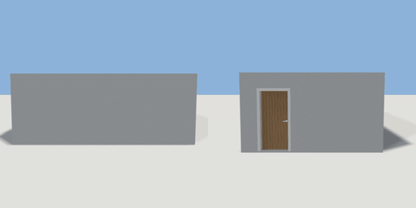

# hotel_suite

`asset: hotel_suite.yaml` · [source](../../../assets/hotel_suite.yaml) · `building.hotel_suite`

 

Hotel suite floor plan: bedroom, ensuite bathroom and an entry corridor.

Rooms are rectangles on wall centre lines ([x, z, width, depth], metres).
Walls are generated from the room boundaries: shared edges become 12 cm
interior walls, outside edges 30 cm exterior walls, with clean junctions.
Surfaces are exported as <room>.<surface> (floor, ceiling, <side>_wall,
and <side>_exterior on outside walls).

```yaml
place:
  hotel_suite: {asset: hotel_suite.yaml}
```

## Size

7.1 x 2.75 x 4.9 m (x, y, z); geometry (-3.55, -0.05, -2.45) to (3.568, 2.7, 2.45) from the origin; 9108 triangles

## Rooms

bedroom (hotel_bedroom), bathroom (hotel_bathroom), corridor (corridor)

## Surfaces

| Surface | Size (u x v, m) | Facing |
| --- | --- | --- |
| `bedroom.floor` | 4.19 x 4.3 | +Y |
| `bedroom.ceiling` | 4.19 x 4.3 | -Y |
| `bedroom.north_wall` | 4.19 x 2.5 | -Z |
| `bedroom.south_wall` | 4.19 x 2.5 | +Z |
| `bedroom.east_wall` | 4.3 x 2.5 | -X |
| `bedroom.west_wall` | 4.3 x 2.5 | +X |
| `bedroom.north_exterior` | 4.19 x 2.5 | +Z |
| `bedroom.south_exterior` | 4.19 x 2.5 | -Z |
| `bedroom.west_exterior` | 4.3 x 2.5 | -X |
| `bathroom.floor` | 2.19 x 2.39 | +Y |
| `bathroom.ceiling` | 2.19 x 2.39 | -Y |
| `bathroom.north_wall` | 2.19 x 2.5 | -Z |
| `bathroom.south_wall` | 2.19 x 2.5 | +Z |
| `bathroom.east_wall` | 2.39 x 2.5 | -X |
| `bathroom.west_wall` | 2.39 x 2.5 | +X |
| `bathroom.south_exterior` | 2.19 x 2.5 | -Z |
| `bathroom.east_exterior` | 2.39 x 2.5 | +X |
| `corridor.floor` | 2.19 x 1.79 | +Y |
| `corridor.ceiling` | 2.19 x 1.79 | -Y |
| `corridor.north_wall` | 2.19 x 2.5 | -Z |
| `corridor.south_wall` | 2.19 x 2.5 | +Z |
| `corridor.east_wall` | 1.79 x 2.5 | -X |
| `corridor.west_wall` | 1.79 x 2.5 | +X |
| `corridor.north_exterior` | 2.19 x 2.5 | +Z |
| `corridor.east_exterior` | 1.79 x 2.5 | +X |
