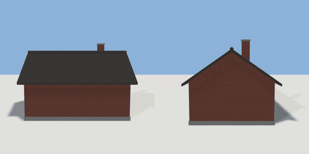

# house_peaked

`asset: house_peaked.yaml` · [source](../../../assets/house_peaked.yaml) · `building.house`

 

Brick cottage shell with a pitched (gable) roof.

The walls are a hollow brick shell, so windows and doors placed on its wall
surfaces cut real openings (see scenes/cottage.yaml). Inside there is an
interior finish: floorboards, a plaster lining (cut by the same openings)
and a ceiling at the wall top. Front faces +Z,
origin at bottom_center.

```yaml
place:
  house_peaked: {asset: house_peaked.yaml, params: {width: 8, depth: 6}}
```

## Params

| Param | Default | Choices | Notes |
| --- | --- | --- | --- |
| `width` | `8` |  |  |
| `depth` | `6` |  |  |
| `wall_height` | `2.8` |  |  |
| `roof_height` | `2.1` |  | ridge rise above the wall top |
| `foundation` | `0.3` |  |  |
| `wall_thickness` | `0.3` |  |  |
| `overhang` | `0.4` |  |  |
| `floor_thickness` | `0.02` |  |  |
| `lining_thickness` | `0.015` |  |  |
| `ceiling_thickness` | `0.03` |  |  |

## Size

8 x 5.2 x 6 m (x, y, z); geometry (-4.4, 0, -3.4) to (4.4, 6.18, 3.4) from the origin; 896 triangles

## Parts

`foundation` (cube), `walls` (cube), `interior` (cube), `floor` (cube), `lining` (cube), `lining_void` (cube), `ceiling` (cube), `gables` (prism), `roof` (roof), `chimney` (cube), `chimney_cap` (cube)

## Surfaces

| Surface | Size (u x v, m) | Facing |
| --- | --- | --- |
| `front_wall` | 8 x 2.8 | +Z |
| `back_wall` | 8 x 2.8 | -Z |
| `left_wall` | 6 x 2.8 | -X |
| `right_wall` | 6 x 2.8 | +X |
| `floor` | 7.4 x 5.4 | +Y |
