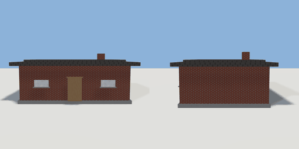

# house_simple

`asset: house_simple.yaml` · [source](../../../assets/house_simple.yaml) · `building.house`

 

Simple house — parametric rectangular house with flat roof.
Front of house faces +Z. Origin is at bottom_center.

Parameters:

```yaml
width:  house width in metres (default 8)
depth:  house depth in metres (default 6)
height: wall height in metres (default 4, incl. foundation)
```

All part sizes use fractions of the top-level `size`, so the visible model
at default params is identical to the pre-parametric version. Override
params at load time (LayoutLoader.load(path, params={"width": 12}) ...)
to generate a different-sized house.

```yaml
place:
  house_simple: {asset: house_simple.yaml, params: {width: 8, depth: 6}}
```

## Params

| Param | Default | Choices | Notes |
| --- | --- | --- | --- |
| `width` | `8` |  |  |
| `depth` | `6` |  |  |
| `height` | `4` |  |  |

## Size

8 x 4 x 6 m (x, y, z); geometry (-4.32, 0, -3.24) to (4.32, 3.58, 3.24) from the origin; 2436 triangles

## Parts

`foundation` (cube), `walls` (cube), `door` (cube), `door_frame_top` (cube), `window_left` (cube), `sill_left` (cube), `window_right` (cube), `sill_right` (cube), `roof` (cube), `roof_cap` (cube), `chimney` (cube)

## Surfaces

| Surface | Size (u x v, m) | Facing |
| --- | --- | --- |
| `front_wall` | 7.6 x 2.4 | +Z |
| `back_wall` | 7.6 x 2.4 | -Z |
| `left_wall` | 5.7 x 2.4 | -X |
| `right_wall` | 5.7 x 2.4 | +X |
| `roof` | 8.64 x 6.48 | +Y |
