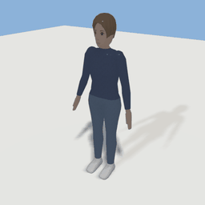
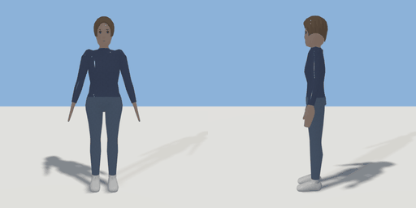

# humanoid

`asset: characters/humanoid.yaml` · [source](../../../assets/characters/humanoid.yaml) · `npc.body`

 

Parametric humanoid body: the humanoid skeleton (assets/skeletons/humanoid.yaml)
skinned by ring-lofted chains (generators/ringloft.py). Stylized ~6.5 heads,
low-poly, one watertight skinned mesh. Continuous shape params; `presets`
are named bundles (params: {preset: feminine, height: 1.6}: explicit values
win). Built in the relaxed `stand` pose over the T-pose rest.

Ring frames: arms have side = up (rx vertical), front = +Z; legs/torso have
side = +X (rx = half width), front = +Z; feet have side = +X, front = up
(rz = half height). Offsets are [side, front] in metres.

```yaml
place:
  humanoid: {asset: characters/humanoid.yaml, params: {preset: feminine, hair_color: white}}
```

## Params

| Param | Default | Choices | Notes |
| --- | --- | --- | --- |
| `height` | `1.72` |  |  |
| `build` | `0.5` |  | 0 slight .. 1 heavy (all flesh radii) |
| `shoulder_width` | `0.34` |  | between the shoulder joints |
| `hip_width` | `0.18` |  | between the hip joints |
| `leg_ratio` | `0.53` |  | hip joint height / height (long legs ~0.55, short ~0.5) |
| `hips` | `1` |  | hip/pelvis flesh width factor |
| `waist` | `0.9` |  | waist width factor |
| `bust` | `0.5` |  | 0 .. 1 |
| `glutes` | `0.5` |  | 0 .. 1 |
| `limb` | `1` |  | arm/leg thickness factor |
| `limb_scale` | `1` |  | body-type multiplier on limb (presets stack without overriding it) |
| `belly` | `0` |  | 0 .. 1: a fuller waist and stomach |
| `head_size` | `1` |  |  |
| `jaw_width` | `1` |  |  |
| `neck_length` | `0.1` |  |  |
| `hand_size` | `1` |  |  |
| `foot_length` | `0.24` |  |  |
| `skin_tone` | `0.25` |  | 0 very light .. 1 very dark (vertex colour over `skin`) |
| `hair_style` | `crop` | none, buzz, crop, pixie, bob, long, ponytail, bun, afro |  |
| `hair_color` | `brown` | black, dark_brown, brown, auburn, blonde, light_blonde, red, grey, white |  |
| `eye_color` | `brown` | brown, dark_brown, hazel, green, blue, grey |  |
| `outfit` | `casual` | none, casual, jeans_tee, smart, dress, skirt_sweater, shorts_tee, casual_f |  |
| `top_color` | `navy` | white, cream, black, charcoal, grey, navy, denim, light_denim, red, burgundy, coral, pink, mustard, olive, green, teal, lavender, brown, tan, sky |  |
| `bottom_color` | `denim` | white, cream, black, charcoal, grey, navy, denim, light_denim, red, burgundy, coral, pink, mustard, olive, green, teal, lavender, brown, tan, sky |  |
| `shoe_color` | `white` | white, cream, black, charcoal, grey, navy, denim, light_denim, red, burgundy, coral, pink, mustard, olive, green, teal, lavender, brown, tan, sky |  |
| `lashes` | `0.3` |  | face paint: 0 .. 1 |
| `lip_strength` | `0.4` |  |  |
| `blush` | `0.1` |  |  |
| `freckles` | `0` |  |  |
| `brow_thickness` | `1.1` |  |  |
| `brow_arch` | `0.8` |  |  |
| `seat_height` | `0.45` |  | seat the sit poses plant the feet for (floor to seat) |
| `table_height` | `0.74` |  |  |
| `sill_height` | `0.95` |  |  |

## Size

0.736 x 1.754 x 0.385 m (x, y, z); geometry (-0.368, -0.009, -0.121) to (0.368, 1.754, 0.192) from the origin; 3550 triangles

## Presets

- feminine: height=1.66, build=0.42, shoulder_width=0.3, hip_width=0.19, hips=1.12, waist=0.8, bust=1, glutes=0.9, limb=0.88, jaw_width=0.86, neck_length=0.1, hand_size=0.92, foot_length=0.23, hair_style=long, outfit=casual_f, top_color=coral, bottom_color=navy, shoe_color=black, lashes=1, lip_strength=0.7, blush=0.35, brow_thickness=0.8, brow_arch=1.2
- masculine: height=1.79, build=0.55, shoulder_width=0.38, hip_width=0.17, hips=0.94, waist=0.84, bust=0, glutes=0.3, limb=1.1, jaw_width=1.12, neck_length=0.11, hand_size=1.05, foot_length=0.26, hair_style=crop, hair_color=dark_brown, outfit=jeans_tee, top_color=grey, bottom_color=denim, shoe_color=white, lashes=0, lip_strength=0.12, blush=0, brow_thickness=1.45, brow_arch=0.4
- slim: build=0.1, limb_scale=0.92
- athletic: build=0.35, limb_scale=1.08, glutes=0.65
- curvy: build=0.6, hips=1.28, waist=0.8, glutes=1
- heavy: build=1.3, limb_scale=1.12, belly=0.85, neck_length=0.085
- hourglass: build=0.5, bust=1.7, hips=1.42, waist=0.66, glutes=1.4
- petite: height=1.53, hand_size=0.88, foot_length=0.215, head_size=1.04, leg_ratio=0.52
- tall: height=1.9, leg_ratio=0.545, foot_length=0.28, hand_size=1.08
- stocky: height=1.64, build=0.75, limb_scale=1.15, belly=0.3, leg_ratio=0.505, neck_length=0.08
- lanky: height=1.86, build=0.1, limb_scale=0.9, leg_ratio=0.555, neck_length=0.12

## Poses

lie, sit, stand

## Clips

get_up, idle, lie_down, pose_lean_on_sill, pose_lie, pose_look, pose_reach_low, pose_sit, pose_sit_at_table, pose_stand, pose_t_pose, sit_down, stand_up, walk, wave
