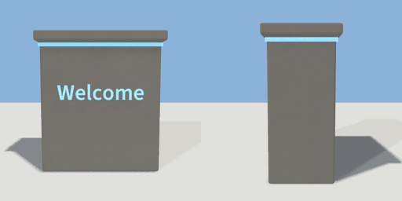

# info_plinth

`asset: info_plinth.yaml` · [source](../../../assets/info_plinth.yaml) · `decor.plinth`

 

A waist-high stone plinth with a lettered front and a glowing cap band:
names a place, or labels a portal or travel door beside it.

```yaml
hub_name: { asset: info_plinth.yaml, params: { label: "Geogen\nHub" } }
```

Origin: bottom centre; the lettering faces +Z.

```yaml
place:
  info_plinth: {asset: info_plinth.yaml, params: {label: Welcome, width: 1}}
```

## Params

| Param | Default | Choices | Notes |
| --- | --- | --- | --- |
| `label` | `Welcome` | text |  |
| `width` | `1` |  |  |
| `height` | `1.1` |  |  |
| `depth` | `0.5` |  |  |
| `letter` | `0.12` |  |  |

## Size

1.08 x 1.18 x 0.58 m (x, y, z); geometry (-0.54, 0, -0.29) to (0.54, 1.18, 0.29) from the origin; 2024 triangles

## Parts

`block` (cube), `cap` (cube), `glow` (cube), `lettering` (text)
