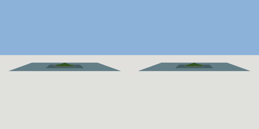

# island_grounds

`asset: island_grounds.yaml` · [source](../../../assets/island_grounds.yaml) · `terrain.island`

 

The island showcase's ground (scenes/island.yaml): terrain rising from sandy
beaches to a wooded hill, levelled pads for the jetty, the hub portal, two
cottages and the lighthouse, gravel paths between them, the sea all round,
and an invisible wall where the water gets half a metre deep (with a gap
where the jetty runs out over it). Positions are in the scene frame.
See assets/island_terrain.yaml for a generic island.

```yaml
place:
  island_grounds: {asset: island_grounds.yaml, params: {sea_level: 2}}
```

## Params

| Param | Default | Choices | Notes |
| --- | --- | --- | --- |
| `sea_level` | `2` |  |  |

## Size

420 x 18.436 x 420 m (x, y, z); geometry (-210, -0.9, -210) to (210, 17.536, 210) from the origin; 61592 triangles

## Parts

`ground` (terrain), `sea` (water)
