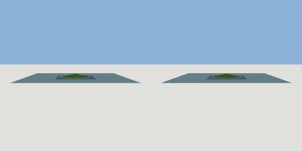

# island_terrain

`asset: island_terrain.yaml` · [source](../../../assets/island_terrain.yaml) · `terrain.island`

 

An island in the sea: noise hills inside a wobbly coastline (sand at the
shore, rock on steep slopes, grass elsewhere), a sea sheet reaching well past
the terrain, and an invisible wall where the water gets half a metre deep.
The sea sits `sea_level` above y = 0 so the Godot runtime's ground plane
(y = 0) is the sea bed beyond the terrain, under the water rather than in it.
`pads` flatten ground for buildings: [{center: [x, z], radius, blend, height?}].
Origin: the middle of the island at y = 0 (the terrain keeps its own heights).

```yaml
place:
  island_terrain: {asset: island_terrain.yaml, params: {extent: 160, peak: 14}}
```

## Params

| Param | Default | Choices | Notes |
| --- | --- | --- | --- |
| `extent` | `160` |  | terrain square (m) |
| `peak` | `14` |  | hill height above the sea |
| `sea_level` | `2` |  |  |
| `sea` | `420` |  | water sheet (m) |
| `seed` | `3` |  |  |

## Size

420 x 17.427 x 420 m (x, y, z); geometry (-210, -0.9, -210) to (210, 16.527, 210) from the origin; 54688 triangles

## Parts

`ground` (terrain), `sea` (water)
