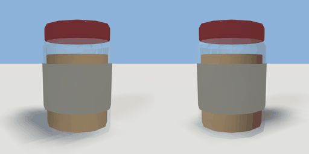

# jar

`asset: jar.yaml` · [source](../../../assets/jar.yaml) · `food.jar`

 

A glass jar of peanut butter or jam. Press E
on the lid to take it off (it lands upside down beside the jar, on +X) and on
the jar to take a knifeful, which raises `scooped`; whether anything gets
spread is up to the scene's rules. Origin: the middle of its base.

```yaml
place:
  jar: {asset: jar.yaml, params: {preset: jam}, state: {lid: open}}
```

## Params

| Param | Default | Choices | Notes |
| --- | --- | --- | --- |
| `spread` | `peanut butter` | text | what the prompts call it |
| `contents` | `peanut_butter` | text | material of what's inside |
| `lid_color` | `car_red` | text | tint names (materials/loader.py) |
| `label_color` | `cream` | text |  |

## Size

0.082 x 0.118 x 0.082 m (x, y, z); geometry (-0.041, 0, -0.041) to (0.041, 0.118, 0.041) from the origin; 552 triangles

## Presets

- peanut_butter: defaults
- jam: spread=jam, contents=jam, lid_color=british_green, label_color=white

## Parts

`glass` (lathe), `contents` (cylinder), `label` (lathe), `lid` (cylinder)

## Interactions

- lid: closed* -> open, open -> closed (* initial; rotates lid)
- scoop: ready* -> scooping, scooping (then ready) (* initial)
