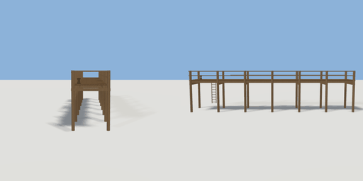

# jetty

`asset: jetty.yaml` · [source](../../../assets/jetty.yaml) · `structure.jetty`

 

A timber jetty on piles: a plank deck on stringers and cross bearers, piles
driven `pile_depth` below the deck that rise above it as the railing posts,
a top and a mid rail on both sides, and a landing at the far end where the
left rail stops for boats (a ladder down, a mooring bollard).
Origin: the middle of the shore end, at deck-top level; the jetty runs out
along +Z. Place it with y = the deck height.

```yaml
place:
  jetty: {asset: jetty.yaml, params: {length: 18, width: 2.4}}
```

## Params

| Param | Default | Choices | Notes |
| --- | --- | --- | --- |
| `length` | `18` |  |  |
| `width` | `2.4` |  |  |
| `pile_depth` | `3.5` |  | piles reach this far below the deck top |
| `landing` | `4` |  | open length on the left at the far end |

## Size

2.9 x 4.5 x 18 m (x, y, z); geometry (-1.45, -3.5, 0) to (1.45, 1, 18) from the origin; 5816 triangles

## Parts

`deck` (cube), `stringer_left` (cube), `stringer_right` (cube), `bearer` (cube), `pile_left` (cylinder), `pile_right` (cylinder), `rail_right` (cube), `midrail_right` (cube), `rail_left` (cube), `midrail_left` (cube), `end_rail` (cube), `ladder_rail_a` (cube), `ladder_rail_b` (cube), `ladder_rung` (cylinder), `bollard` (lathe)
