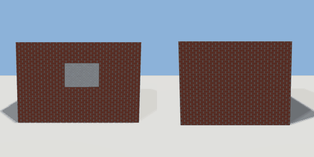

# kitchen

`asset: kitchen.yaml` · [source](../../../assets/kitchen.yaml) · `building.kitchen`

 

A small domestic kitchen: one tiled room. The door is on the south wall and
the window on the north, over where the counter goes. Unfurnished: scenes
place the units on `kitchen.floor` (scenes/sandwich_kitchen.yaml).

```yaml
place:
  kitchen: {asset: kitchen.yaml}
```

## Size

4.5 x 2.95 x 3.9 m (x, y, z); geometry (-2.25, -0.05, -1.968) to (2.25, 2.9, 1.95) from the origin; 2244 triangles

## Rooms

kitchen (kitchen)

## Surfaces

| Surface | Size (u x v, m) | Facing |
| --- | --- | --- |
| `kitchen.floor` | 3.9 x 3.3 | +Y |
| `kitchen.ceiling` | 3.9 x 3.3 | -Y |
| `kitchen.north_wall` | 3.9 x 2.7 | -Z |
| `kitchen.south_wall` | 3.9 x 2.7 | +Z |
| `kitchen.east_wall` | 3.3 x 2.7 | -X |
| `kitchen.west_wall` | 3.3 x 2.7 | +X |
| `kitchen.north_exterior` | 3.9 x 2.7 | +Z |
| `kitchen.south_exterior` | 3.9 x 2.7 | -Z |
| `kitchen.east_exterior` | 3.3 x 2.7 | +X |
| `kitchen.west_exterior` | 3.3 x 2.7 | -X |
