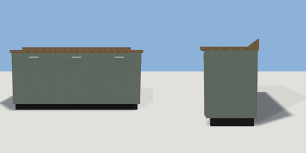

# kitchen_counter

`asset: kitchen_counter.yaml` · [source](../../../assets/kitchen_counter.yaml) · `kitchen.counter` `furniture.counter`

 

A fitted kitchen counter: base units under a worktop. Against a wall (back
at -Z), worked from the front. Things go on the `top` surface.

```yaml
place:
  kitchen_counter: {asset: kitchen_counter.yaml, params: {width: 1.9}}
```

## Params

| Param | Default | Choices | Notes |
| --- | --- | --- | --- |
| `width` | `1.9` |  |  |

## Size

1.92 x 0.98 x 0.64 m (x, y, z); geometry (-0.96, 0, -0.32) to (0.96, 0.98, 0.32) from the origin; 1176 triangles

## Parts

`plinth` (cube), `carcass` (cube), `door` (cube), `handle` (cube), `worktop` (cube), `upstand` (cube)

## Surfaces

| Surface | Size (u x v, m) | Facing |
| --- | --- | --- |
| `top` | 1.92 x 0.64 | +Y |

## Clearance

front 0.9
