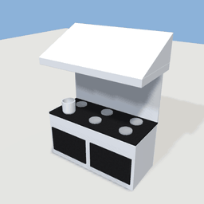
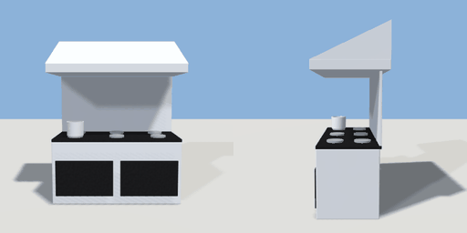

# kitchen_range

`asset: kitchen_range.yaml` · [source](../../../assets/kitchen_range.yaml) · `kitchen.range` `appliance`

 

A commercial range: a stainless six-burner cooker with oven doors, a
splashback and an extractor hood above. Against a wall (back at -Z); the
cook stands in front (+Z).

```yaml
place:
  kitchen_range: {asset: kitchen_range.yaml, params: {width: 1.8}}
```

## Params

| Param | Default | Choices | Notes |
| --- | --- | --- | --- |
| `width` | `1.8` |  |  |

## Size

1.9 x 2.4 x 0.95 m (x, y, z); geometry (-0.95, 0, -0.495) to (0.95, 2.4, 0.455) from the origin; 1872 triangles

## Parts

`body` (cube), `top` (cube), `oven_left` (cube), `oven_right` (cube), `burner_1` (cylinder), `burner_2` (cylinder), `burner_3` (cylinder), `burner_4` (cylinder), `burner_5` (cylinder), `burner_6` (cylinder), `pot` (lathe), `splashback` (cube), `hood` (prism), `hood_lip` (cube)

## Affordances

stand at (0, 0, 0.66) [staff, cook]

## Clearance

front 1
