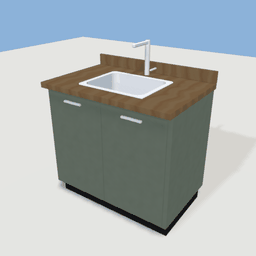
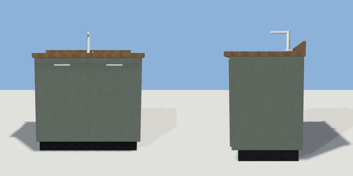

# kitchen_sink

`asset: kitchen_sink.yaml` · [source](../../../assets/kitchen_sink.yaml) · `kitchen.sink` `kitchen.counter` `furniture.counter`

 

A kitchen sink unit: a base unit under a worktop with an inset steel bowl and a mixer
tap. Against a wall (back at -Z), worked from the front; matches kitchen_counter.yaml.
Washing up here takes a dirty plate (the link after a meal in a household's chain).

```yaml
place:
  kitchen_sink: {asset: kitchen_sink.yaml, params: {width: 0.95}}
```

## Params

| Param | Default | Choices | Notes |
| --- | --- | --- | --- |
| `width` | `0.95` |  |  |

## Size

0.97 x 1.14 x 0.64 m (x, y, z); geometry (-0.485, 0, -0.32) to (0.485, 1.14, 0.32) from the origin; 1760 triangles

## Parts

`plinth` (cube), `carcass` (cube), `door` (cube), `handle` (cube), `worktop` (cube), `upstand` (cube), `bowl_void` (cube), `bowl` (extrude), `bowl_cavity` (extrude), `tap_body` (cylinder), `tap_spout` (cube), `tap_lever` (cube)

## Surfaces

| Surface | Size (u x v, m) | Facing |
| --- | --- | --- |
| `top` | 0.97 x 0.64 | +Y |

## Affordances

stand at (0, 0, 0.7) [household]

## Clearance

front 0.9
