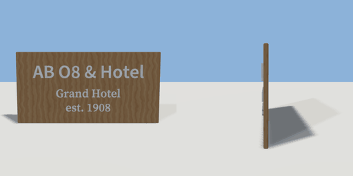

# lettering

`asset: lettering.yaml` · [source](../../../assets/lettering.yaml)

 

Review asset for primitive: text (extruded lettering, sans and serif, letters with counters).

```yaml
place:
  lettering: {asset: lettering.yaml, params: {label: AB O8 & Hotel}}
```

## Params

| Param | Default | Choices | Notes |
| --- | --- | --- | --- |
| `label` | `AB O8 & Hotel` | text |  |

## Size

2.6 x 1.3 x 0.09 m (x, y, z); geometry (-1.3, 0, -0.03) to (1.3, 1.3, 0.06) from the origin; 7044 triangles

## Parts

`board` (cube), `sans` (text), `serif` (text)
