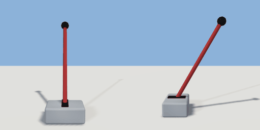

# lever

`asset: lever.yaml` · [source](../../../assets/lever.yaml) · `switch.lever`

 

A floor lever: a cast base with a handle that throws forward and back.
Origin: bottom centre; the handle leans back (-Z) when up and forward (+Z) when
pulled. Wiring hears `pulled` / `released`; `jam` / `free` stop and allow it
(a jammed lever says so when someone tries it).

```yaml
place:
  lever: {asset: lever.yaml, params: {height: 0.9}, state: down}
```

## Params

| Param | Default | Choices | Notes |
| --- | --- | --- | --- |
| `height` | `0.9` |  | handle length, base to knob |

## Size

0.34 x 0.946 x 0.61 m (x, y, z); geometry (-0.17, 0, -0.49) to (0.17, 0.946, 0.12) from the origin; 576 triangles

## Parts

`base` (cube), `slot` (cube), `handle` (cylinder), `knob` (sphere)

## Interactions

pull: up* -> down, down -> up (* initial; rotates handle)

## Clearance

front 0.6, back 0.6
