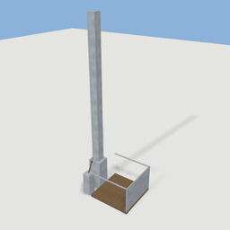
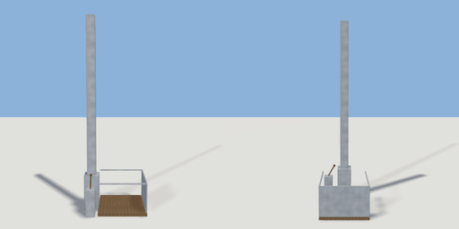

# lift_platform

`asset: lift_platform.yaml` · [source](../../../assets/lift_platform.yaml) · `machine.lift` `mechanism.lift`

 

A goods lift: a platform that rides up a mast. A mechanism: a body on a slide joint with a
motor. The lever at the mast's foot calls it: `ride` goes `down` → `rising` → `up` → `lowering` →
`down`, the drive motion running the motor up or down and braking at each end; the
lever can be used from the platform (`reach`). Step on and ride it `rise` metres up.
Origin: the mast's foot; the platform reaches out along +X, its deck 0.15 m up.

```yaml
place:
  lift_platform: {asset: lift_platform.yaml, params: {rise: 4, speed: 1}, state: rising}
```

## Params

| Param | Default | Choices | Notes |
| --- | --- | --- | --- |
| `rise` | `4` |  |  |
| `speed` | `1` |  | m/s |
| `width` | `1.6` |  |  |

## Size

2.1 x 6.6 x 1.6 m (x, y, z); geometry (-0.45, 0, -0.8) to (1.65, 6.6, 0.8) from the origin; 1500 triangles

## Parts

`mast` (cube), `deck` (cube), `cage` (cube), `rail_side` (cube), `rail_end` (cube), `pedestal` (cube), `handle` (cylinder), `knob` (sphere)

## Attachments

| Attachment | Position | Facing |
| --- | --- | --- |
| `deck` | (0.85, 0.15, 0) | center |

## Interactions

ride: down* -> rising, rising (then up after 4 s), up -> lowering, lowering (then down after 4 s) (* initial; drive ; rotates handle)
