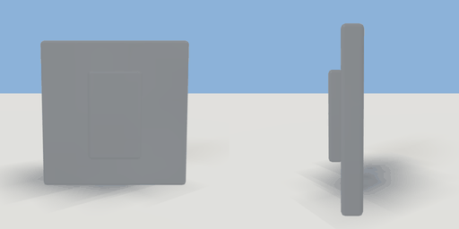

# light_switch

`asset: light_switch.yaml` · [source](../../../assets/light_switch.yaml) · `switch.light`

 

Wall light switch: a plate with a rocker that tips when switched off.
Origin: bottom-centre on the wall, faces +Z. `light` names the fixture it
turns on and off: a placement of the same scene.

```yaml
place:
  light_switch: {asset: light_switch.yaml, params: {light: }, state: off}
```

## Params

| Param | Default | Choices | Notes |
| --- | --- | --- | --- |
| `light` | `` | text | the light fixture it switches (a placement's name) |

## Size

0.085 x 0.085 x 0.02 m (x, y, z); geometry (-0.043, 0, 0) to (0.043, 0.085, 0.017) from the origin; 216 triangles

## Parts

`plate` (cube), `rocker` (cube)

## Interactions

switch: on* -> off, off -> on (* initial; rotates rocker)
