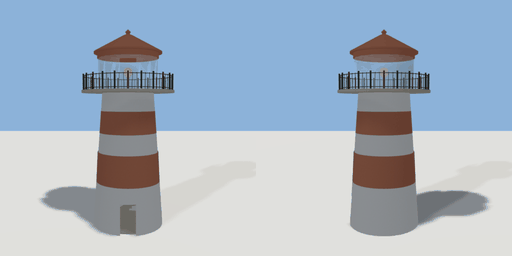

# lighthouse

`asset: lighthouse.yaml` · [source](../../../assets/lighthouse.yaml) · `structure.lighthouse`

 

A lighthouse you can climb: a tapering white tower with red bands, a doorway
on +Z into the ground floor, a spiral stair round a central column up to the
gallery deck, a glazed lantern room (with a doorway out onto the gallery,
which has a railing), a red cap, and the lamp on top of the stair column. The
lamp's light comes on at night (`light: auto: night`).
Origin: bottom centre of the tower; the deck is `height` up.

```yaml
place:
  lighthouse: {asset: lighthouse.yaml, params: {height: 10, base_r: 2.6}}
```

## Params

| Param | Default | Choices | Notes |
| --- | --- | --- | --- |
| `height` | `10` |  | gallery deck top |
| `base_r` | `2.6` |  | tower outer radius at the ground |
| `top_r` | `1.9` |  | ... under the gallery |
| `wall` | `0.35` |  |  |

## Size

6.8 x 14.4 x 6.8 m (x, y, z); geometry (-3.4, 0, -3.4) to (3.4, 14.4, 3.4) from the origin; 9062 triangles

## Parts

`tower` (lathe), `interior` (lathe), `doorway` (cube), `window` (cube), `band_window` (cube), `band_1` (lathe), `band_2` (lathe), `ground_floor` (extrude), `stair` (stairs), `deck` (extrude), `gallery_railing` (fence), `lantern` (lathe), `lantern_door` (cube), `lantern_sill` (lathe), `cap` (lathe), `lamp` (lathe)

## Light

type omni, color [1,0.9,0.7], energy 12, range 40, offset [0,11.25,0], auto night
