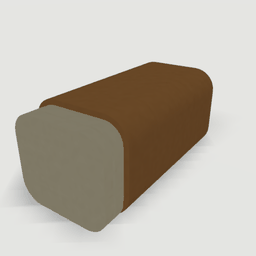
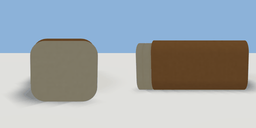

# loaf

`asset: loaf.yaml` · [source](../../../assets/loaf.yaml) · `food.bread`

 

A loaf of bread with two slices cut at its +Z end. Press E to take a slice:
they go one at a time (`slices`: two, one, none), raising `taken` each time.
What becomes of a slice is up to the scene's rules, which can also put one
back by setting `slices`. Origin: the middle of its base.

```yaml
place:
  loaf: {asset: loaf.yaml, state: one}
```

## Size

0.12 x 0.11 x 0.232 m (x, y, z); geometry (-0.06, 0, -0.1) to (0.06, 0.11, 0.132) from the origin; 560 triangles

## Parts

`body` (extrude), `cut_face` (extrude), `slice_1` (extrude), `slice_2` (extrude)

## Interactions

slices: two* -> one, one -> none, none (* initial; translates slice_2; translates slice_1)
