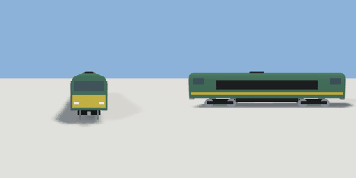

# loco

`asset: vehicles/loco.yaml` · [source](../../../assets/vehicles/loco.yaml) · `vehicle.rail` `vehicle.loco`

 

A diesel locomotive: cabs with windscreens at both ends, louvred engine
sides, head and tail lamps, two bogies. Same frame as carriage.yaml: built
along +Z, origin on the rail head midway between the bogies, left = +X,
parts in metres.

```yaml
place:
  loco: {asset: vehicles/loco.yaml, params: {paint: orange, stripe: silver}}
```

## Params

| Param | Default | Choices | Notes |
| --- | --- | --- | --- |
| `length` | `17` |  |  |
| `width` | `2.8` |  |  |
| `bogie_gap` | `10.5` |  |  |
| `wheel_r` | `0.5` |  |  |
| `gauge` | `1.435` |  |  |
| `floor` | `1.15` |  |  |
| `paint` | `british_green` | british_green, bus_red, car_navy, maroon, graphite, taxi_yellow, orange |  |
| `stripe` | `taxi_yellow` | taxi_yellow, car_white, cream, car_red, silver |  |

## Size

2.83 x 4.06 x 17.9 m (x, y, z); geometry (-1.415, 0, -8.95) to (1.415, 4.06, 8.95) from the origin; 3476 triangles

## Parts

`body` (extrude), `stripe` (cube), `cab_front` (cube), `cab_rear` (cube), `cab_side_front` (cube), `cab_side_rear` (cube), `louvres` (cube), `exhaust` (cube), `warning_front` (cube), `warning_rear` (cube), `headlight_left` (cube), `headlight_right` (cube), `taillight_left` (cube), `taillight_right` (cube), `underframe` (cube), `coupler_front` (cube), `coupler_rear` (cube), `bogie_front` (cube), `bogie_rear` (cube), `wheel_ff_l` (cylinder), `wheel_ff_r` (cylinder), `wheel_fr_l` (cylinder), `wheel_fr_r` (cylinder), `wheel_rf_l` (cylinder), `wheel_rf_r` (cylinder), `wheel_rr_l` (cylinder), `wheel_rr_r` (cylinder)

## Vehicle

class loco, max_speed 30, turn_radius 150, accel 2, decel 4, wheelbase 13, track 1.495, clearance [17.9,2.83,4.06]
