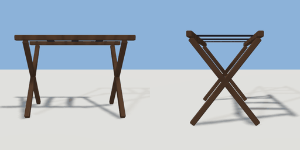

# luggage_rack

`asset: luggage_rack.yaml` · [source](../../../assets/luggage_rack.yaml) · `furniture.luggage_rack`

 

Folding luggage rack: two X-braced wooden frames with webbing straps.
Origin bottom_center, long side along X.

```yaml
place:
  luggage_rack: {asset: luggage_rack.yaml, params: {width: 0.7, depth: 0.45}}
```

## Params

| Param | Default | Choices | Notes |
| --- | --- | --- | --- |
| `width` | `0.7` |  |  |
| `depth` | `0.45` |  |  |
| `height` | `0.52` |  |  |

## Size

0.7 x 0.52 x 0.45 m (x, y, z); geometry (-0.35, 0.024, -0.19) to (0.35, 0.52, 0.19) from the origin; 684 triangles

## Parts

`rail_front` (cube), `rail_back` (cube), `leg_left_a` (cube), `leg_left_b` (cube), `leg_right_a` (cube), `leg_right_b` (cube), `strap_1` (cube), `strap_2` (cube), `strap_3` (cube)

## Surfaces

| Surface | Size (u x v, m) | Facing |
| --- | --- | --- |
| `top` | 0.7 x 0.03 | +Y |

## Clearance

front 0.5
