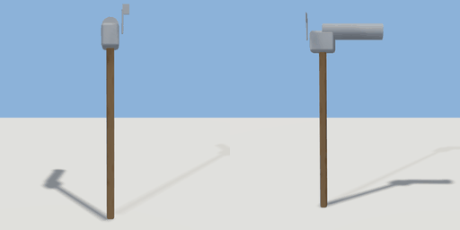

# mailbox

`asset: mailbox.yaml` · [source](../../../assets/mailbox.yaml) · `street.mailbox`

 

US rural-style mailbox on a post
Tunnel-shaped box on wooden post
Origin is at bottom_center

```yaml
place:
  mailbox: {asset: mailbox.yaml, params: {width: 0.5, height: 1.2}}
```

## Params

| Param | Default | Choices | Notes |
| --- | --- | --- | --- |
| `width` | `0.5` |  |  |
| `height` | `1.2` |  |  |
| `depth` | `0.5` |  |  |

## Size

0.5 x 1.2 x 0.5 m (x, y, z); geometry (-0.055, 0, -0.42) to (0.115, 1.374, 0.105) from the origin; 488 triangles

## Parts

`post` (cube), `box_base` (cube), `box_top` (cylinder), `flag_arm` (cube), `flag` (cube)
