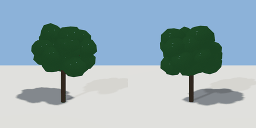

# maple_tree

`asset: maple_tree.yaml` · [source](../../../assets/maple_tree.yaml) · `vegetation.tree`

 

Maple tree - a space-colonisation branch skeleton with leaf clusters
(generators/nature.py). Origin is at bottom_center.
`scale` multiplies every dimension; `seed` grows a different tree.

```yaml
place:
  maple_tree: {asset: maple_tree.yaml, params: {scale: 1, seed: 1}}
```

## Params

| Param | Default | Choices | Notes |
| --- | --- | --- | --- |
| `scale` | `1` |  |  |
| `seed` | `1` |  |  |
| `height` | `5.2` |  | crown top (m, before scale) |
| `trunk` | `0.38` |  | clear trunk as a share of the height (street trees: ~0.6, crown above buses) |

## Size

4.177 x 5.38 x 4.314 m (x, y, z); geometry (-2.041, -0.02, -2.213) to (2.136, 5.36, 2.101) from the origin; 4164 triangles

## Parts

`tree` (tree)
