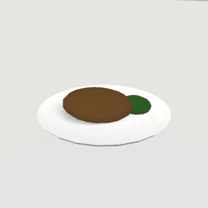
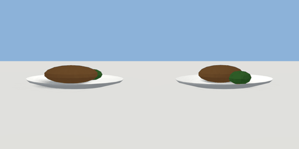

# meal_plate

`asset: meal_plate.yaml` · [source](../../../assets/meal_plate.yaml) · `decor.plate` `food.meal`

 

A cooked meal on a plate: what a range or a microwave makes of raw food (items/meal.yaml),
eaten at a table.

```yaml
place:
  meal_plate: {asset: meal_plate.yaml}
```

## Size

0.27 x 0.054 x 0.27 m (x, y, z); geometry (-0.135, 0, -0.135) to (0.135, 0.054, 0.135) from the origin; 616 triangles

## Parts

`plate` (lathe), `stew` (ellipsoid), `greens` (ellipsoid)
