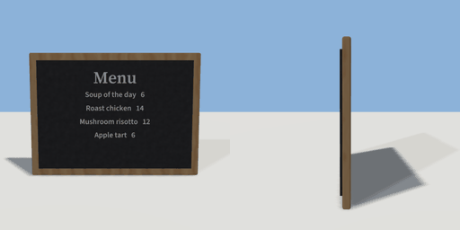

# menu_board

`asset: menu_board.yaml` · [source](../../../assets/menu_board.yaml) · `decor.menu_board` `decor.wall`

 

A wall-mounted chalkboard menu in a wooden frame. Wall-mounted: origin on
the wall plane at the board's bottom centre, depth along +Z.

```yaml
place:
  menu_board: {asset: menu_board.yaml, params: {title: Menu}}
```

## Params

| Param | Default | Choices | Notes |
| --- | --- | --- | --- |
| `title` | `Menu` | text |  |

## Size

1.1 x 0.8 x 0.055 m (x, y, z); geometry (-0.55, 0, 0) to (0.55, 0.8, 0.055) from the origin; 12016 triangles

## Parts

`frame` (cube), `board` (cube), `title` (text), `items` (text)
