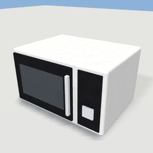
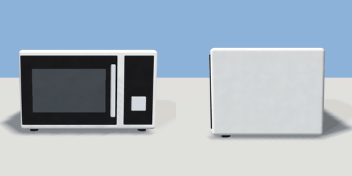

# microwave

`asset: microwave.yaml` · [source](../../../assets/microwave.yaml) · `kitchen.microwave` `appliance`

 

A countertop microwave oven: a white case, a dark glass door with a handle and a control
panel with a knob. Sits on a counter (`on: counter.top`), door facing +Z.
It turns raw food into a meal, quicker than a range does (geogen.101.5).

```yaml
place:
  microwave: {asset: microwave.yaml}
```

## Size

0.48 x 0.292 x 0.383 m (x, y, z); geometry (-0.24, -0.012, -0.18) to (0.24, 0.28, 0.203) from the origin; 840 triangles

## Parts

`case` (cube), `door` (cube), `window` (cube), `handle` (cube), `panel` (cube), `dial` (cube), `foot` (cylinder)

## Affordances

stand at (0, 0, 0.75) [household]
