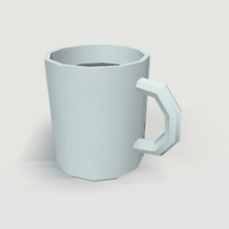
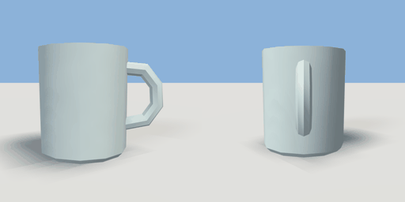

# mug

`asset: mug.yaml` · [source](../../../assets/mug.yaml) · `decor.mug` `prop.mug`

 

A coffee mug: a glazed body with a loop handle on its +X side. People take it by the handle
(motion drink: `handle`, grip hook) and drink from it. Origin: the middle of its base; it faces
+Z like any prop, so whoever stands on its +Z side has the handle at their right hand.

```yaml
place:
  mug: {asset: mug.yaml, params: {colour: duck_egg}}
```

## Params

| Param | Default | Choices | Notes |
| --- | --- | --- | --- |
| `colour` | `duck_egg` | text |  |

## Size

0.115 x 0.095 x 0.082 m (x, y, z); geometry (-0.041, 0, -0.041) to (0.074, 0.095, 0.041) from the origin; 260 triangles

## Parts

`body` (lathe), `coffee` (cylinder), `handle` (sweep)

## Attachments

| Attachment | Position | Facing |
| --- | --- | --- |
| `handle` | (0.062, 0.052, 0) | center |
