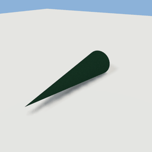
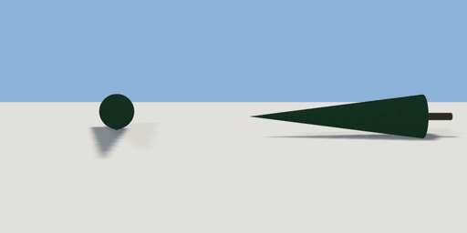

# netted_tree

`asset: netted_tree.yaml` · [source](../../../assets/netted_tree.yaml) · `decor.christmas`

 

A netted fir lying where it was left, waiting to be brought in (geogen.110). Lies along Z with
the cut end toward -Z, which is where someone stands to take it.

```yaml
place:
  netted_tree: {asset: netted_tree.yaml, state: taken}
```

## Size

0.42 x 0.42 x 1.925 m (x, y, z); geometry (-0.21, 0, -1) to (0.21, 0.42, 0.925) from the origin; 112 triangles

## Parts

`trunk` (cylinder), `boughs` (cone)

## Interactions

stock: here*, taken (* initial; shows/hides trunk, boughs)

## Affordances

stand at (0, 0, -1.4) [errand]
