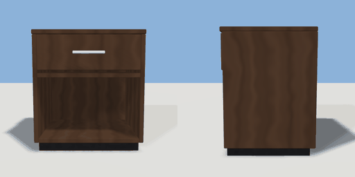

# nightstand

`asset: nightstand.yaml` · [source](../../../assets/nightstand.yaml) · `furniture.nightstand`

 

Bedside table: carcass with an open shelf, one drawer that slides out
(interaction 'drawer'), on a plinth. Origin bottom_center, front +Z.

```yaml
place:
  nightstand: {asset: nightstand.yaml, params: {width: 0.5, height: 0.55}, state: open}
```

## Params

| Param | Default | Choices | Notes |
| --- | --- | --- | --- |
| `width` | `0.5` |  |  |
| `height` | `0.55` |  |  |
| `depth` | `0.4` |  |  |
| `board` | `0.02` |  |  |
| `drawer` | `0.16` |  | drawer front height |

## Size

0.5 x 0.55 x 0.4 m (x, y, z); geometry (-0.25, 0, -0.2) to (0.25, 0.55, 0.22) from the origin; 1176 triangles

## Parts

`top` (cube), `side_left` (cube), `side_right` (cube), `back` (cube), `bottom` (cube), `shelf` (cube), `plinth` (cube), `drawer_box` (cube), `drawer_front` (cube), `handle` (cube)

## Surfaces

| Surface | Size (u x v, m) | Facing |
| --- | --- | --- |
| `top` | 0.5 x 0.4 | +Y |

## Interactions

drawer: closed* -> open, open -> closed (* initial; translates drawer_box, drawer_front, handle)

## Container

capacity 4, part drawer_box

## Clearance

front 0.5
