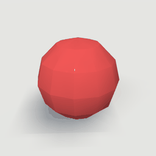
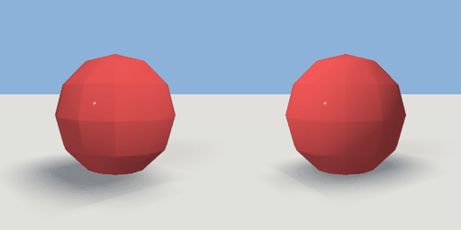

# ornament

`asset: ornament.yaml` · [source](../../../assets/ornament.yaml) · `decor.christmas`

 

One glass Christmas ornament, as it is carried from the box to the tree (items/ornament.yaml).

```yaml
place:
  ornament: {asset: ornament.yaml}
```

## Size

0.09 x 0.09 x 0.09 m (x, y, z); geometry (-0.045, 0, -0.045) to (0.045, 0.09, 0.045) from the origin; 120 triangles

## Parts

`ball` (sphere)
