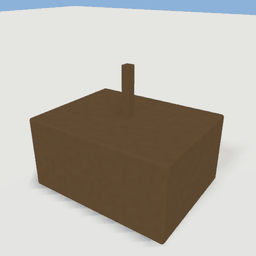
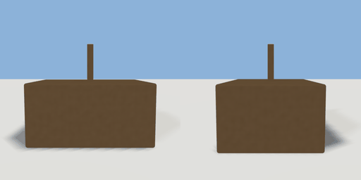

# ornament_box

`asset: ornament_box.yaml` · [source](../../../assets/ornament_box.yaml) · `decor.christmas`

 

A cardboard box of Christmas ornaments with a string handle (items/ornament_box.yaml).

```yaml
place:
  ornament_box: {asset: ornament_box.yaml}
```

## Size

0.36 x 0.3 x 0.28 m (x, y, z); geometry (-0.18, 0, -0.14) to (0.18, 0.3, 0.14) from the origin; 312 triangles

## Parts

`box` (cube), `handle` (cube)
