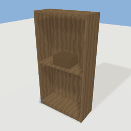
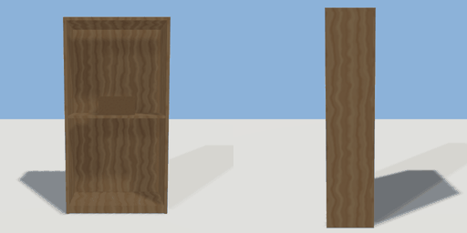

# ornament_cupboard

`asset: ornament_cupboard.yaml` · [source](../../../assets/ornament_cupboard.yaml) · `furniture.storage`

 

A tall open cupboard with the box of Christmas ornaments on its middle shelf (geogen.110).
Origin on the floor at the middle of its back; it faces +Z.

```yaml
place:
  ornament_cupboard: {asset: ornament_cupboard.yaml, state: taken}
```

## Size

1 x 1.9 x 0.42 m (x, y, z); geometry (-0.5, 0, 0) to (0.5, 1.9, 0.42) from the origin; 372 triangles

## Parts

`back` (cube), `left` (cube), `right` (cube), `top` (cube), `base` (cube), `shelf` (cube), `box` (cube)

## Interactions

stock: here*, taken (* initial; shows/hides box)

## Affordances

stand at (0, 0, 0.8) [errand]
