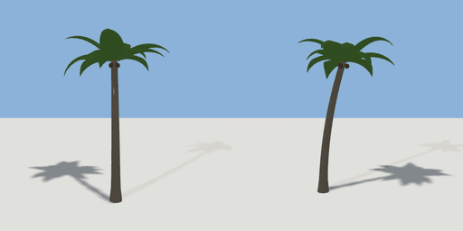

# palm_tree

`asset: palm_tree.yaml` · [source](../../../assets/palm_tree.yaml) · `vegetation.tree` `vegetation.palm`

 

Palm tree - a curved, leaning trunk with a crown of arched fronds and
coconuts (generators/nature.py, style: palm). Origin is at bottom_center.
`seed` changes the lean and the frond layout.

```yaml
place:
  palm_tree: {asset: palm_tree.yaml, params: {scale: 1, seed: 1}}
```

## Params

| Param | Default | Choices | Notes |
| --- | --- | --- | --- |
| `scale` | `1` |  |  |
| `seed` | `1` |  |  |
| `height` | `6.5` |  | crown top (m, before scale) |
| `fronds` | `11` |  |  |

## Size

4.405 x 7.004 x 4.467 m (x, y, z); geometry (-2.206, -0.024, -3.335) to (2.199, 6.98, 1.132) from the origin; 1528 triangles

## Parts

`tree` (tree)
