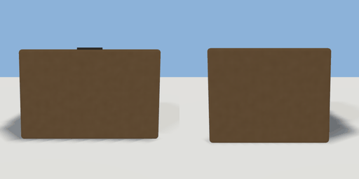

# parcel

`asset: parcel.yaml` · [source](../../../assets/parcel.yaml) · `prop.parcel`

 

A taped cardboard parcel: a belt item for conveyors (items/parcel.yaml). Origin: bottom
centre; the tape runs front to back.

```yaml
place:
  parcel: {asset: parcel.yaml, params: {width: 0.34, height: 0.22}}
```

## Params

| Param | Default | Choices | Notes |
| --- | --- | --- | --- |
| `width` | `0.34` |  |  |
| `height` | `0.22` |  |  |
| `depth` | `0.28` |  |  |

## Size

0.34 x 0.223 x 0.284 m (x, y, z); geometry (-0.17, 0, -0.142) to (0.17, 0.223, 0.142) from the origin; 312 triangles

## Parts

`box` (cube), `tape` (cube)
