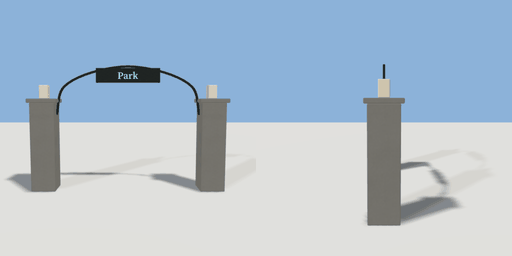

# park_gate

`asset: park_gate.yaml` · [source](../../../assets/park_gate.yaml) · `decor.gate`

 

A park gateway: two stone piers with lanterns, a wrought-iron arch between
them and a lettered sign hung from it. The opening is `width` wide (leave a
matching gap in the railings). Origin: bottom centre of the opening; faces +Z.

```yaml
place:
  park_gate: {asset: park_gate.yaml, params: {label: Park, width: 3.6}}
```

## Params

| Param | Default | Choices | Notes |
| --- | --- | --- | --- |
| `label` | `Park` | text |  |
| `width` | `3.6` |  | clear opening between the piers |
| `pier` | `0.6` |  |  |
| `height` | `2.2` |  | pier height |

## Size

4.92 x 3.125 x 0.72 m (x, y, z); geometry (-2.46, 0, -0.36) to (2.46, 3.125, 0.36) from the origin; 3528 triangles

## Parts

`pier_left` (cube), `pier_right` (cube), `cap_left` (cube), `cap_right` (cube), `lantern_left` (cube), `lantern_right` (cube), `arch` (sweep), `sign` (cube), `label_front` (text), `label_back` (text)

## Light

type omni, color [1,0.85,0.6], energy 0.8, range 7, offset [0,3.6,0.4], auto night
