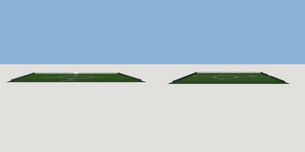

# park_grounds

`asset: park_grounds.yaml` · [source](../../../assets/park_grounds.yaml) · `terrain.park`

 

The park's grounds: a lawn, a network of gravel paths (tagged park.path, which
park visitors walk) and railings round the edge with a gap for the gate at
the south (-Z) end. Used by scenes/park.yaml; origin: the park's centre.

```yaml
place:
  park_grounds: {asset: park_grounds.yaml}
```

## Size

74 x 1.33 x 60 m (x, y, z); geometry (-37, 0, -30) to (37, 1.33, 30) from the origin; 28624 triangles

## Parts

`lawn` (cube), `paths` (paths), `railings` (fence)
