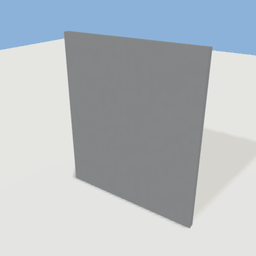
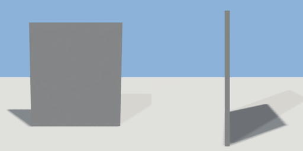

# partition_wall

`asset: partition_wall.yaml` · [source](../../../assets/partition_wall.yaml) · `building.wall`

 

An interior partition: a plastered stud wall that divides a room (a bathroom in the corner of
a one-room cottage). A door placed on `front` or `back` cuts its own opening through it:

```yaml
bath_wall: { asset: partition_wall.yaml, params: { length: 2.0 }, on: house.floor, at: {...}, facing: west }
bath_door: { asset: door.yaml, on: bath_wall.front, at: { u: 0.5, v: { abs: 0 } } }
```

Origin is the bottom centre; the wall runs along X and `front` faces +Z.

```yaml
place:
  partition_wall: {asset: partition_wall.yaml, params: {length: 2.4, height: 2.75}}
```

## Params

| Param | Default | Choices | Notes |
| --- | --- | --- | --- |
| `length` | `2.4` |  |  |
| `height` | `2.75` |  |  |
| `thickness` | `0.1` |  |  |

## Size

2.4 x 2.75 x 0.1 m (x, y, z); geometry (-1.2, 0, -0.05) to (1.2, 2.75, 0.05) from the origin; 12 triangles

## Parts

`wall` (cube)

## Surfaces

| Surface | Size (u x v, m) | Facing |
| --- | --- | --- |
| `front` | 2.4 x 2.75 | +Z |
| `back` | 2.4 x 2.75 | -Z |
