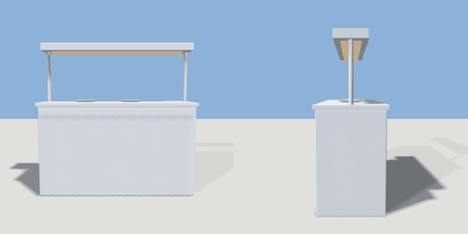

# pass

`asset: pass.yaml` · [source](../../../assets/pass.yaml) · `kitchen.pass` `furniture.counter`

 

The pass: a stainless counter where plates wait to go out, under a gantry
of heat lamps. Stands free (staff on both sides); runs along X.

```yaml
place:
  pass: {asset: pass.yaml, params: {width: 1.6}}
```

## Params

| Param | Default | Choices | Notes |
| --- | --- | --- | --- |
| `width` | `1.6` |  |  |

## Size

1.64 x 1.58 x 0.64 m (x, y, z); geometry (-0.82, 0, -0.32) to (0.82, 1.58, 0.32) from the origin; 1008 triangles

## Parts

`counter` (cube), `top` (cube), `post_l` (cylinder), `post_r` (cylinder), `gantry` (cube), `lamps` (cube), `plate_1` (lathe), `plate_2` (lathe)

## Light

type omni, color [1,0.7,0.45], energy 0.6, range 3, offset [0,1.3,0]

## Clearance

front 0.8, back 0.8
